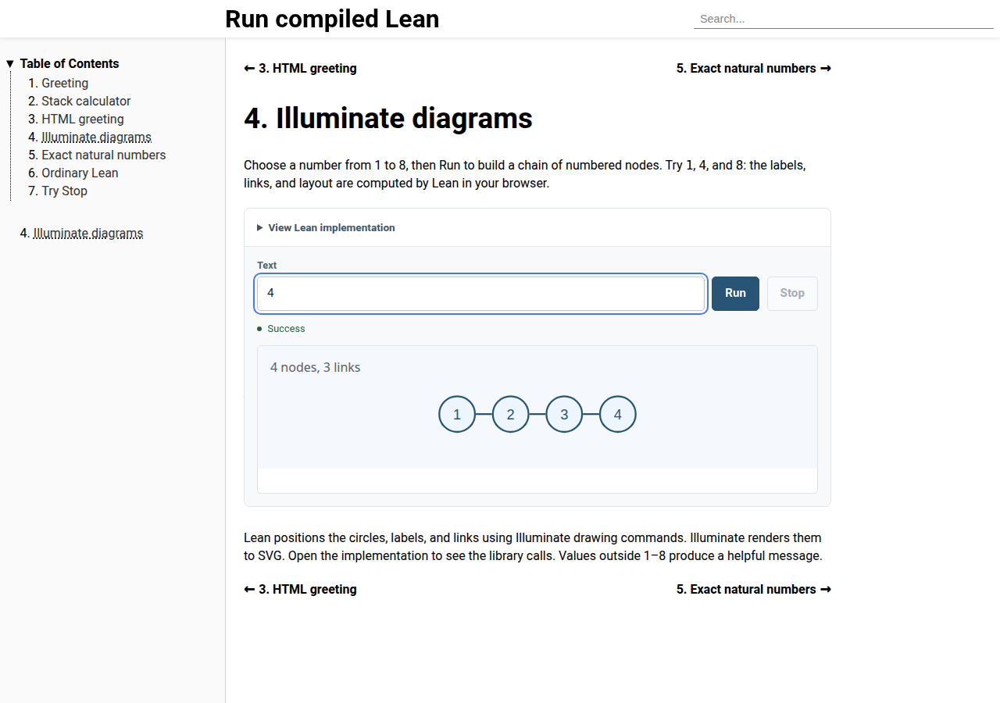

# verso-run

**Runnable Lean examples for Verso documents.**

verso-run runs Lean functions interactively from compiled Verso documents.
Functions can return primitive values, HTML (including SVG), or recorded and
live views. Authors define the computation and its display in Lean; readers
supply inputs and run the published examples in their browser.

Functions can be defined in the document or imported from a Lean module.
Execution uses [VIR](https://github.com/ejgallego/lean-vir) in a dedicated worker;
**Stop** interrupts a running example. Readers need no Lean installation.
Manual, Blog pages and posts, and Slides are supported.

[Demo](https://ejgallego.github.io/verso-run/) ·
[User guide](https://ejgallego.github.io/verso-run/guide/) ·
[View API](https://ejgallego.github.io/verso-run/api/) ·
[Manual starter](examples/manual-starter/README.md)

[](https://github.com/ejgallego/verso-run/actions/workflows/ci.yml)



## Try it locally

Install [elan](https://github.com/leanprover/elan) and Python 3. The checkout selects
Lean 4.36.0-rc1 and fetches its compatible dependencies and runtime.

```sh
git clone https://github.com/ejgallego/verso-run.git
cd verso-run
lake build
python3 scripts/build-demo-site.py
python3 -m http.server 8795 --bind 127.0.0.1 --directory _out/html-multi
```

Open [the demo](http://127.0.0.1:8795/), the
[user guide](http://127.0.0.1:8795/guide/), or the
[API reference](http://127.0.0.1:8795/api/).
The guide covers authoring, imported functions, HTML results, sequences and
automata, genre setup, hosting, and troubleshooting. Lean examples remain
readable without JavaScript; Manual also retains TeX output.

To start a document of your own, copy the [Manual starter](examples/manual-starter/README.md)
and follow its version-pinned instructions.

## Contributing

[Contributing](CONTRIBUTING.md) covers development, checks, and documentation.
The [library map](docs/internals.md#library-boundaries) explains the source layout.
User-guide sources live in `doc/`; the View API explanations live beside the
public library in `src/views/`. [Architecture](docs/internals.md),
[validation](docs/validation.md), [history](docs/history.md), and the
[roadmap](ROADMAP.md) remain in Markdown.

Licensed under [Apache-2.0](LICENSE).
