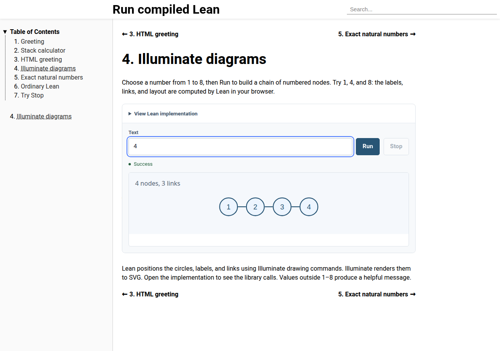

# verso-run

**Runnable Lean examples for Verso documents.**

verso-run runs Lean functions interactively from compiled Verso documents.
Functions can return primitive values, HTML (including SVG), or recorded and
live views. Authors define the computation and its display in Lean; readers
supply inputs and run the published examples in their browser.

Functions can be defined in the document or imported from a Lean module.
Execution uses [VIR](https://github.com/ejgallego/lean-vir) in a dedicated worker;
**Stop** interrupts a running example. Readers need no Lean installation.
Manual, Blog pages and posts, and Slides are supported.

[Published demo](https://ejgallego.github.io/verso-run/) ·
[User guide](https://ejgallego.github.io/verso-run/guide/) ·
[View API](https://ejgallego.github.io/verso-run/api/) ·
[Manual starter](examples/manual-starter/README.md)

[](https://github.com/ejgallego/verso-run/actions/workflows/ci.yml)



## Explore the published examples

These links open the demo published from `main`. Readers can run the examples
without installing Lean.

| Example | Try |
| --- | --- |
| [Game of Life](https://ejgallego.github.io/verso-run/Game-of-Life/) | Edit a seed, then Play continuously or Step once |
| [Stack stepper](https://ejgallego.github.io/verso-run/Stack-stepper/) | Inspect the stack before and after each instruction |
| [Stack calculator](https://ejgallego.github.io/verso-run/Stack-calculator/) | `6 7 * 2 +`, then `5 dup *` |
| [HTML greeting](https://ejgallego.github.io/verso-run/HTML-greeting/) | A name containing `<b>&` to see text escaping |
| [Illuminate diagrams](https://ejgallego.github.io/verso-run/Illuminate-diagrams/) | `1`, `4`, and `8` nodes |
| [Exact natural numbers](https://ejgallego.github.io/verso-run/Exact-natural-numbers/) | `9007199254740993` |
| [Try Stop](https://ejgallego.github.io/verso-run/Try-Stop/) | Start a large calculation, then interrupt it |
| [Blog page](https://ejgallego.github.io/verso-run/blog/page/) | Exact natural numbers from an imported source anchor |
| [Blog post](https://ejgallego.github.io/verso-run/blog/notes/2026-10-8-running-lean-in-a-post/) | Greetings, an HTML card, and Stop |
| [Slides](https://ejgallego.github.io/verso-run/slides/) | Run exact numbers and greetings, then navigate away to stop work |
| [Typed inputs](https://ejgallego.github.io/verso-run/Typed-inputs/) | Boolean choices and UInt64 maximum/wraparound |
| [Multiline text](https://ejgallego.github.io/verso-run/Multiline-text/) | Keep blank lines and number each line |

## Try it locally

Install [elan](https://github.com/leanprover/elan) and Python 3. The checkout selects
Lean 4.36.0-rc1 and fetches its compatible dependencies and runtime.

```sh
git clone https://github.com/ejgallego/verso-run.git
cd verso-run
lake build
python3 scripts/build-demo-site.py
python3 -m http.server 8795 --bind 127.0.0.1 --directory _out/html-multi
```

After the server starts, open the [local landing page](http://127.0.0.1:8795/).
Its links open the demo, user guide and API reference built from this checkout.
The guide covers authoring, imported functions, HTML results, sequences and
automata, genre setup, hosting, and troubleshooting. Lean examples remain
readable without JavaScript; Manual also retains TeX output.

To start a document of your own, copy the [Manual starter](examples/manual-starter/README.md)
and follow its version-pinned instructions. It currently uses Lean 4.35 and an
earlier verso-run API, including `Verso.Output.Html`. Its
[version-specific authoring guide](https://github.com/ejgallego/verso-run/blob/f2a1491257b8ad0c71b0468abf909c6dcfda9459/docs/authoring.md)
applies to that project; the guide and API reference here describe the current checkout.

## Contributing

[Contributing](CONTRIBUTING.md) covers development, checks, and documentation.
The [library map](docs/internals.md#library-boundaries) explains the source layout.
User-guide sources live in `doc/`; the View API explanations live beside the
public library in `src/views/`. [Architecture](docs/internals.md),
[validation](docs/validation.md), [history](docs/history.md), and the
[roadmap](ROADMAP.md) remain in Markdown.

Licensed under [Apache-2.0](LICENSE).
